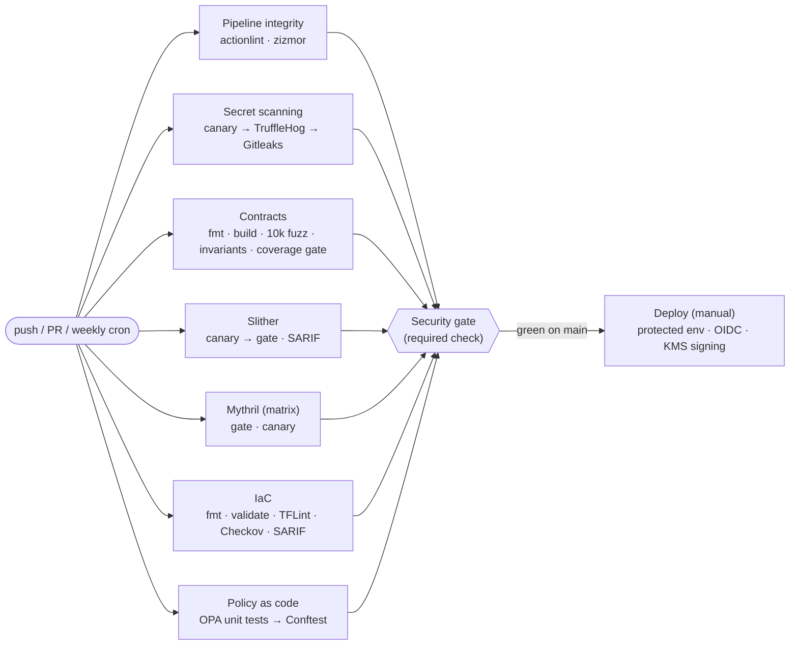
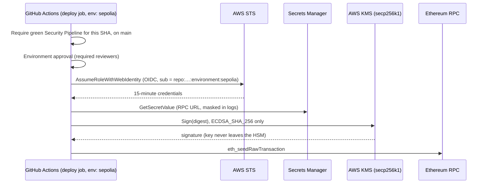

# Automated Web3 DevSecOps Pipeline

[](https://github.com/Haxsen/automated-web3-devsecops-pipeline/actions/workflows/security-pipeline.yml)


A GitHub Actions security pipeline for smart contracts and the cloud infrastructure that deploys
them. Every push runs a set of security gates:

- **Secret scanning:** TruffleHog, plus Gitleaks with custom Web3 rules, across the full git history.
- **Smart contract analysis:** Slither for static analysis and Mythril for symbolic execution.
- **Testing:** Foundry fuzzing and stateful invariant tests.
- **Infrastructure checks:** Checkov, TFLint and OPA policy-as-code on the Terraform.

A single required status check, **Security gate**, blocks merges and deployments until all of them pass.

Deployments are **keyless**. The deployer's secp256k1 private key is generated inside AWS KMS and can
never be exported. CI gets short-lived credentials through GitHub OIDC and signs transactions inside
KMS, so there is no private key in GitHub, a `.env` file or a laptop.

---

## Pipeline



| Stage | Tools | What it catches | Fails the build when |
| --- | --- | --- | --- |
| Pipeline integrity | actionlint, zizmor | Broken workflows, script injection, over-broad tokens, unpinned actions, credential persistence | Any finding |
| Secret scanning | TruffleHog, Gitleaks + custom rules | Verified cloud/SaaS credentials, **EVM private keys, BIP-39 mnemonics, Infura/Alchemy/QuickNode RPC keys, Etherscan keys** anywhere in history | Any finding, or the canary misses a planted secret |
| Contracts | Foundry | Logic bugs: 10,000 runs per fuzz test; 4 invariants × 256 runs × 128-call sequences | Any failure, or coverage below 100% lines / 95% branches |
| Static analysis | Slither | 100+ vulnerability detectors | Any Low+ finding not triaged inline, or the canary is not flagged |
| Symbolic execution | Mythril | Reachable exploit paths (SWC registry) | Any Medium+ issue, analysis crash, or the canary is not flagged |
| IaC | Terraform, TFLint, Checkov | Invalid config, AWS anti-patterns, 80+ cloud misconfigurations | Any unsuppressed finding; provider hashes that don't match the lockfile |
| Policy as code | OPA / Conftest | Web3-specific infra rules (below) | Any deny, or any failing policy unit test |

Findings from Slither, Checkov and Gitleaks are uploaded as SARIF to **GitHub Code Scanning**, so they
show up inline on pull requests.

## What makes it more than a tool checklist

### 1. Scanner canaries: proving the gates actually work

A security gate that silently stops detecting is worse than none, because it makes green builds
meaningless. On every run the pipeline feeds each scanner a known-bad input and fails if the
scanner doesn't flag it:

- **Slither** must flag `reentrancy-eth`, `tx-origin` and `arbitrary-send-eth` in
  [`VulnerableVault.sol`](contracts/canary/VulnerableVault.sol).
- **Mythril** must report SWC-107 (reentrancy) and SWC-115 (tx.origin) in the same contract.
- **Gitleaks** must catch 7 kinds of Web3 secret that
  [`secret_canary.sh`](scripts/secret_canary.sh) generates fresh at runtime. Nothing key-shaped is ever
  committed.

[`ReentrancyExploit.t.sol`](contracts/test/canary/ReentrancyExploit.t.sol) shows that the canary
bug is real: an attacker with 1 ETH drains 11 ETH.

Building the canaries surfaced two real tool behaviours:

- Mythril 0.24.8's built-in compiler downloader points at a retired domain.
- Mythril exits `0` even when it crashes.

A naive `myth analyze` step would have reported green while analysing nothing.
[`mythril_gate.py`](scripts/mythril_gate.py) reads the report instead of trusting the exit code.

### 2. Keyless, gated deployments



### 3. Web3-specific policy as code

Generic IaC scanners don't know that a signing key must use secp256k1, or that a loose OIDC subject
lets a fork PR sign mainnet transactions. [`policies/terraform`](policies/terraform) adds
Rego guardrails for these cases, with 23 unit tests:

- Signing keys must be `ECC_SECG_P256K1`, have `prevent_destroy`, and use the 30-day deletion window.
- **Separation of duties:** no principal may hold both key administration (`PutKeyPolicy`, `ScheduleKeyDeletion`, …) and `kms:Sign`.
- `kms:Sign` must be constrained to `ECDSA_SHA_256` over `DIGEST` messages.
- GitHub OIDC trust must use exact `StringEquals` on a `repo:…:environment:…` or `…:ref:refs/heads/main` subject (no wildcards, `StringLike` or `pull_request`), and must check `aud`. `${local.*}` references are resolved before judging.
- No secret values in Terraform state, no private-key or mnemonic input variables, and no raw 32-byte hex anywhere in the configuration.

### 4. The pipeline secures itself

- `permissions: {}` by default, with a minimal grant per job.
- Every action is pinned to a full commit SHA, and every container image by digest.
- Python tooling is installed from a hash-locked requirements file (`--require-hashes --no-deps`).
- Terraform provider checksums are locked for 5 platforms (`-lockfile=readonly`).
- No persisted git credentials; runner egress is audited with `harden-runner`.
- Dependabot keeps everything current with a 7-day cooldown against freshly compromised releases.
- CODEOWNERS covers every security-critical path.

### 5. A contract built for defence in depth

[`SecureVault.sol`](contracts/src/SecureVault.sol) is the vault the pipeline protects. Its controls:

- Role-based access with separation of duties: guardians can pause, only the admin can unpause.
- A reentrancy guard plus checks-effects-interactions.
- Fee-on-transfer-safe balance-delta accounting.
- A rolling outflow rate limit (circuit breaker).
- A rescue path that cannot touch user funds.

Accepted scanner findings are triaged inline, next to the code, with a written justification. They are
not hidden in a global config.

## Verified results

Every gate was run locally in the same pinned containers CI uses:

| Gate | Result |
| --- | --- |
| Foundry tests | **23/23 passed**: 10 fuzz tests × 10,000 runs each; 4 invariants checked across 32,768 random calls |
| Coverage (`src/`) | **100% lines, 100% branches, 100% functions** |
| Slither | **0 findings** (2 triaged inline); canary: 3/3 detectors fired |
| Mythril | **0 issues** on SecureVault; canary: SWC-107 + SWC-115 found |
| Checkov | **80 passed, 0 failed**, 8 skips (each justified inline) |
| TFLint / `terraform validate` | Clean |
| OPA / Conftest | **23/23 policy unit tests**, all rules pass on the real Terraform |
| Gitleaks canary | **7/7** Web3 secret types detected |
| actionlint + zizmor | **0 findings** |

## Repository layout

```text
.github/
  workflows/security-pipeline.yml   the security gauntlet
  workflows/deploy.yml              gated, keyless deployment (OIDC + KMS)
  dependabot.yml, CODEOWNERS
contracts/                          Foundry project
  src/SecureVault.sol               hardened vault
  canary/VulnerableVault.sol        INTENTIONALLY vulnerable scanner canary (never deployed)
  test/                             unit, fuzz, invariant (handler-based) and exploit tests
  script/Deploy.s.sol               deploy script (signer supplied via --aws)
  slither.config.json
infra/terraform/                    KMS signing key, GitHub OIDC role, Secrets Manager, alerting
policies/terraform/                 OPA/Rego Web3 guardrails + unit tests
scripts/                            gate and canary helpers (coverage, Mythril, Slither, secrets)
requirements/                       hash-locked Python tooling
docs/THREAT_MODEL.md                assets, threats → controls, accepted risks, runbooks
.gitleaks.toml, .checkov.yaml, .pre-commit-config.yaml, Makefile
```

## Run it locally

You need only Docker and `make`; every tool runs in the same pinned image as in CI.

```bash
git clone --recurse-submodules https://github.com/Haxsen/automated-web3-devsecops-pipeline
cd automated-web3-devsecops-pipeline

make help        # list targets
make test        # fmt + build + 10k-run fuzz + invariants
make coverage    # coverage report + gate
make slither     # canary + gate
make secrets     # canary + TruffleHog + Gitleaks
make iac         # terraform fmt/validate + TFLint + Checkov
make policy      # OPA unit tests + Conftest
make workflows   # actionlint + zizmor
make mythril     # symbolic execution (~10 min)
```

Optional shift-left: `pre-commit install` runs Gitleaks, `forge fmt` and `terraform fmt` before each
commit.

## Enabling it on GitHub

1. **Branch protection** on `main`:
   - Require the **Security gate** status check.
   - Require pull requests and review from Code Owners.
2. **Code scanning**: SARIF upload works out of the box on public repositories.
3. **Deployments** (optional, needs an AWS account):
   1. `cd infra/terraform`, copy `terraform.tfvars.example` to `terraform.tfvars`, fill it in, then `terraform init -backend-config=backend.hcl && terraform apply`.
   2. Set the RPC URL out-of-band: `aws secretsmanager put-secret-value --secret-id <rpc_url_secret_arn> --secret-string "$RPC_URL"`.
   3. Create a GitHub Environment named `sepolia` with required reviewers. Add these as environment *variables* (they are identifiers, not secrets):
      - `AWS_REGION`, `AWS_DEPLOY_ROLE_ARN`, `DEPLOYER_KMS_KEY_ARN`, `RPC_URL_SECRET_ARN` (from the Terraform outputs)
      - `VAULT_ASSET`, `VAULT_ADMIN`, `VAULT_WITHDRAW_LIMIT`
   4. Fund the deployer address: `AWS_KMS_KEY_ID=<arn> cast wallet address --aws`.
   5. Run **Deploy (KMS-signed)**. It simulates by default; tick *broadcast* to send.

## Design decisions

- **Two smart-contract analysers.** Slither is fast, pattern-based and runs on every push. Mythril
  finds reachable paths that patterns miss, and runs as a parallel matrix job so it never blocks
  feedback from the faster gates.
- **Slither fails on Low, Mythril on Medium.** Slither supports inline triage
  (`slither-disable-next-line` with a justification), so a strict threshold stays workable. Mythril
  has no inline suppression, so a Low threshold would cause un-silenceable false positives.
- **Scanners run as digest-pinned containers.** The CI command and the `make` target are the same
  command against the same image. The trade-off is that Dependabot can't bump image digests;
  Renovate's regex manager could.
- **`harden-runner` is in audit mode.** Moving to `block` needs an egress allowlist built from a few
  weeks of audit data.

See [docs/THREAT_MODEL.md](docs/THREAT_MODEL.md) for the full threat → control mapping and the
accepted risks.

## Roadmap

- [ ] Container signing and SLSA provenance (Cosign) for a containerised RPC proxy.
- [ ] Kubernetes NetworkPolicies and rate limiting for a self-hosted RPC node.
- [ ] Echidna / Medusa for coverage-guided invariant fuzzing alongside Foundry.
- [ ] `harden-runner` in block mode with an egress allowlist.
